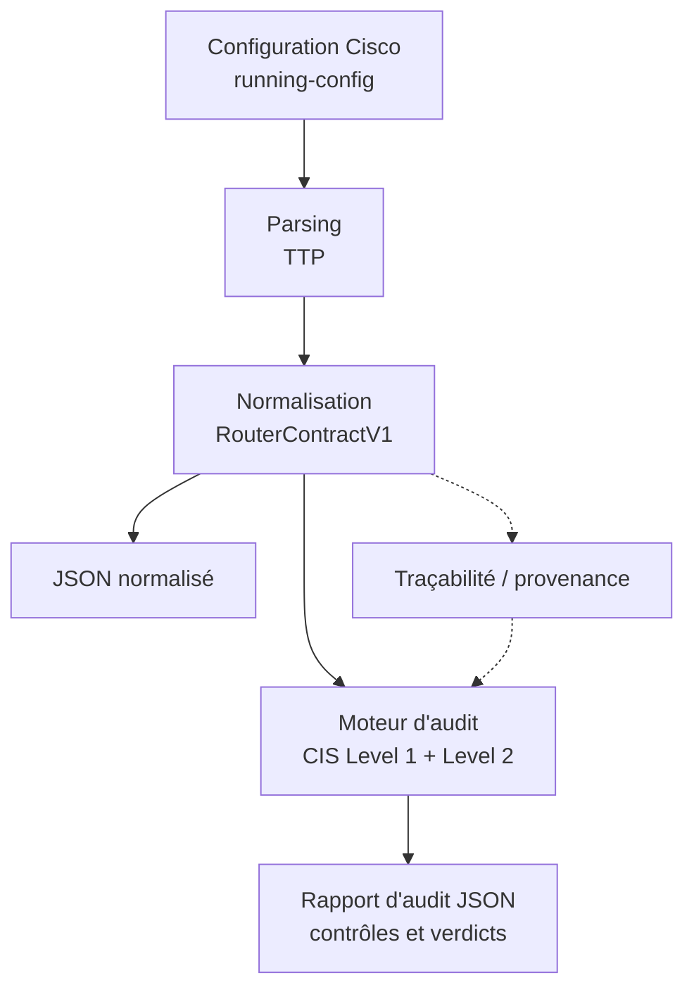

# Moteur d’audit de configurations Cisco

**Projet tutoré — SUP’COM | Cisco IOS / IOS-XE · Parsing TTP · Normalisation JSON · Audit CIS**

Ce dépôt contient un outil d’analyse statique des configurations de routeurs Cisco. À partir d’un fichier `running-config`, il extrait les paramètres de l’équipement, les normalise dans un modèle JSON commun, puis applique des contrôles de sécurité issus du **CIS Cisco IOS 15 Benchmark v4.1.1**.

L’objectif est de faciliter la lecture de configurations hétérogènes et de fournir des résultats d’audit structurés, consultables depuis une interface web locale ou exploitables par d’autres outils.

> **Périmètre actuel :** configurations Cisco IOS et IOS-XE. L’outil n’établit pas, à lui seul, une certification de conformité ni la sécurité opérationnelle d’un équipement.

## Sommaire

- [Fonctionnalités](#fonctionnalités)
- [Architecture](#architecture)
- [Installation et démarrage](#installation-et-démarrage)
- [Utilisation](#utilisation)
- [Résultats d’audit](#résultats-daudit)
- [Organisation du dépôt](#organisation-du-dépôt)
- [Périmètre et limites](#périmètre-et-limites)
- [Contexte académique](#contexte-académique)

## Fonctionnalités

| Composant | Fonction |
|---|---|
| **Parsing** | Extraction des commandes Cisco avec des modèles **TTP** et prise en compte du contexte des commandes. |
| **Normalisation** | Transformation des données extraites en un document JSON conforme au contrat **`RouterContractV1`** (Pydantic). |
| **Moteur CIS** | Analyse des configurations selon le catalogue **CIS Cisco IOS 15 v4.1.1**, avec un profil cumulatif **Level 1 + Level 2**. |
| **Interprétation** | Distinction entre configuration conforme, non conforme, non applicable et situation nécessitant une vérification. |
| **Traçabilité** | Association des résultats à des éléments de configuration normalisés et, lorsque disponible, à leur provenance. |
| **Interface web** | Import d’un fichier, visualisation du JSON, filtres sur les contrôles, consultation des résultats et exports. |

### Couverture du référentiel

Le catalogue intégré contient **90 recommandations CIS**. Dans le périmètre limité à l’analyse d’un `running-config` :

- **88 contrôles** sont éligibles à l’évaluation ;
- **85 contrôles** disposent d’un traitement automatique ;
- **3 contrôles** demandent une appréciation manuelle ;
- **2 recommandations** ne peuvent pas être vérifiées à partir du seul fichier de configuration.

Ces chiffres indiquent la **couverture fonctionnelle du moteur**, pas un taux de conformité des routeurs ni une mesure globale de précision.

## Architecture



Le traitement part d’une configuration fournie par l’utilisateur. Il n’effectue **aucune connexion SSH aux routeurs** et n’applique **aucune modification** à leur configuration.

**Chaîne technique :** `parser/run_ttp.py` → `normalizer/engine.py` → `schemas/router_contract_v1.py` → `audit/cis.py`. L’application web est exposée localement par `webapp.py`, avec une analyse isolée dans un processus de travail.

## Installation et démarrage

### Prérequis

- **Windows x64 et Python 3.12** pour l’installation hors ligne fournie par le dépôt ;
- **PowerShell** pour les scripts `setup.ps1` et `run_ui.ps1` ;
- Un navigateur web récent pour l’interface.

Le dépôt comprend `requirements.lock` et un dossier `wheelhouse/` contenant les dépendances prévues pour l’installation hors ligne sur Windows x64 / Python 3.12.

### 1. Récupérer le projet

```powershell
git clone https://github.com/Achref88MANSOURI/Projet_Tutore_moteur_d-audit_cisco.git
cd Projet_Tutore_moteur_d-audit_cisco
```

### 2. Préparer l’environnement

```powershell
.\setup.ps1
```

Le script crée un environnement virtuel `.venv` et installe les dépendances depuis `wheelhouse/`. Si plusieurs versions de Python sont installées, préciser l’interpréteur Python 3.12 :

```powershell
.\setup.ps1 -Python "C:\chemin\vers\Python312\python.exe"
```

### 3. Lancer l’interface

```powershell
.\run_ui.ps1
```

Ouvrir ensuite **http://127.0.0.1:8000** dans un navigateur.

Le serveur écoute uniquement sur `127.0.0.1`. Pour l’arrêter, utiliser **Ctrl+C** dans le terminal.

> Sur un autre système d’exploitation, le script d’installation hors ligne n’est pas garanti compatible. Les dépendances Python figurent dans `requirements.lock` ; une installation adaptée à la plateforme peut être nécessaire.

## Utilisation

### Depuis l’interface web

1. Importer un fichier `.cfg`, `.conf`, `.config` ou `.txt` contenant une configuration Cisco, ou coller son contenu.
2. Indiquer la famille du système : **IOS** ou **IOS-XE**.
3. Lancer l’analyse pour obtenir le JSON normalisé et les résultats du profil **CIS Level 1 + Level 2**.
4. Parcourir les contrôles par statut, famille ou niveau, et consulter les informations associées.
5. Exporter, selon le besoin, le rapport d’audit JSON, la liste CSV des résultats, le JSON normalisé ou un rapport HTML.

L’interface accepte des configurations jusqu’à **2 Mio**. Un exemple de laboratoire peut être chargé directement depuis l’application.

### Depuis la ligne de commande : normalisation

Le fichier `cli.py` permet de produire un `normalized.json` sans lancer le serveur web :

```powershell
.\.venv\Scripts\python.exe cli.py .\routeur.cfg --os-family ios --output .\outputs\routeur
```

**Résultat :** `outputs/routeur/normalized.json`.

Pour une configuration IOS-XE, remplacer `--os-family ios` par `--os-family iosxe`.

### Depuis l’API locale : normalisation et audit

L’interface utilise notamment :

| Méthode | Route | Rôle |
|---|---|---|
| `GET` | `/api/health` | Vérification du serveur. |
| `GET` | `/api/catalog` | Métadonnées des contrôles CIS. |
| `POST` | `/api/normalize` | Normalisation d’une configuration. |
| `POST` | `/api/analyze` | Normalisation, audit et provenance dans une seule analyse. |

Exemple de requête vers `/api/analyze` :

```json
{
  "configuration": "hostname Router-01\nservice password-encryption\n",
  "os_family": "ios",
  "input_completeness": "complete"
}
```

La réponse contient notamment `normalized` (configuration normalisée), `audit` (résultats CIS) et `provenance` (traçabilité). Le profil CIS appliqué par l’application est cumulatif.

## Résultats d’audit

Pour chaque contrôle, le rapport fournit un identifiant CIS, un titre, un verdict, une justification, ainsi que les informations de preuve, de portée et d’applicabilité disponibles.

| Verdict | Signification |
|---|---|
| **`PASS`** | Les éléments de configuration observés satisfont la condition vérifiée. |
| **`FAIL`** | Une non-conformité est établie au regard de la condition vérifiée. |
| **`NEEDS_REVIEW`** | Les données disponibles ne permettent pas une décision suffisamment fondée ; une vérification complémentaire est requise. |
| **`NOT_APPLICABLE`** | Le contrôle ne s’applique pas à la configuration examinée, lorsque cette situation peut être établie. |

Extrait représentatif des champs d’un résultat (présentation abrégée) :

```json
{
  "check_id": "CIS-1.1.1",
  "title": "Enable 'aaa new-model'",
  "status": "PASS",
  "applicability": "APPLICABLE"
}
```

Les verdicts portent sur les **conditions observables dans le fichier**, et non sur la disponibilité effective des services ou la sécurité du réseau dans son ensemble.

## Organisation du dépôt

```text
.
├── audit/                  # Catalogue CIS, contrôles, moteurs et résolveurs
│   ├── catalog/            # Référentiel CIS et périmètre d'exécution
│   ├── resolvers/          # Résolution de relations et de paramètres de routage
│   └── rules/              # Évaluation des règles de sécurité
├── normalizer/             # Transformation des captures en données structurées
│   └── domains/            # Interfaces, AAA, ACL, routage, services, VPN...
├── parser/                 # Extraction et validation des commandes
├── schemas/                # Contrat RouterContractV1 et schéma JSON
├── templates/              # Modèles TTP Cisco IOS
├── web/
│   └── index.html          # Tableau de bord
├── wheelhouse/             # Dépendances pour installation hors ligne
├── cis_operation.py        # Orchestration de l'analyse CIS
├── cli.py                  # Interface en ligne de commande
├── web_analysis.py         # Traitement de l'analyse pour l'application web
├── webapp.py               # Serveur HTTP local et API
├── setup.ps1               # Préparation de l'environnement
├── run_ui.ps1              # Démarrage sous Windows
└── requirements.lock       # Versions des dépendances Python
```

**Principales technologies :** Python, TTP, Pydantic, JSON Schema, HTML/CSS/JavaScript et PowerShell.

## Périmètre et limites

- **Référentiel :** le catalogue repose sur le *CIS Cisco IOS 15 Benchmark v4.1.1*. Les versions d’IOS et d’IOS-XE peuvent différer en matière de commandes, de fonctionnalités et de valeurs par défaut. Un verdict ne doit pas être transposé sans vérification à toutes les versions.
- **Source de données :** le moteur analyse la configuration fournie. Il ne vérifie pas directement l’état des équipements, la connectivité, les sessions réseau ni les sorties des commandes `show`.
- **Incertitude :** lorsqu’une information manque ou ne peut pas être déduite avec fiabilité, le moteur peut retourner `NEEDS_REVIEW` plutôt qu’un verdict catégorique.
- **Portée fonctionnelle :** ce dépôt met en œuvre la chaîne d’audit des **routeurs Cisco**. L’audit des proxys et des solutions SD-WAN relève du sujet académique plus large, mais ne doit pas être considéré comme implémenté ici.
- **Confidentialité :** les configurations peuvent contenir des informations sensibles. Utiliser des fichiers autorisés et assainis avant tout partage public. Les configurations importées ne sont pas conservées comme fichiers sur le serveur web local.

## Contexte académique

Ce travail s’inscrit dans le **projet tutoré de SUP’COM** consacré à l’**audit et à l’analyse des configurations de routeurs, proxys et SD-WAN**.

La réalisation présentée dans ce dépôt se concentre sur un **moteur d’audit Cisco fondé sur la normalisation des configurations et les recommandations CIS**.

**Auteurs :** Achref Mansouri et Mohamed Amine Ouni.

---

*Dépôt académique de développement et d’expérimentation. Les résultats doivent être interprétés en fonction de la version de l’équipement, du périmètre du fichier analysé et des preuves disponibles.*
